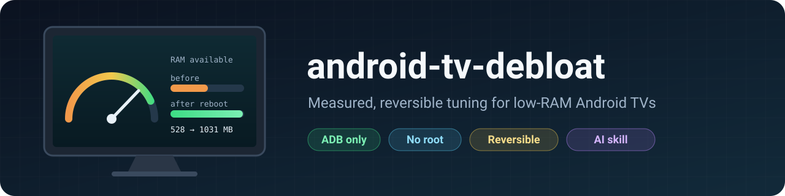
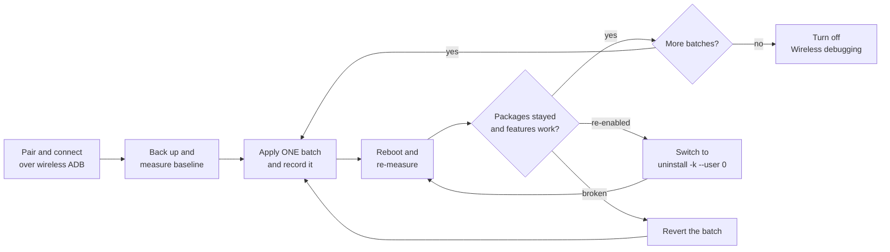
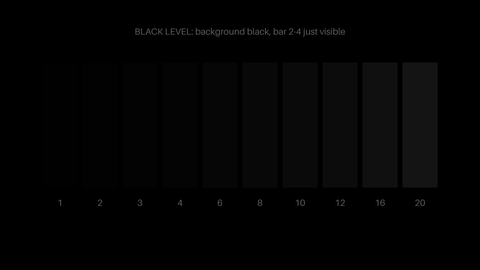
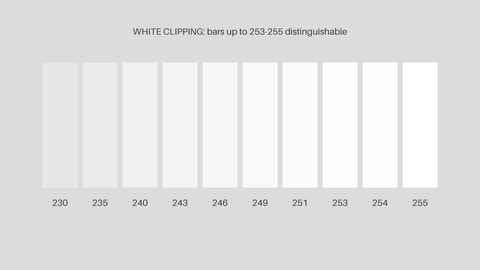
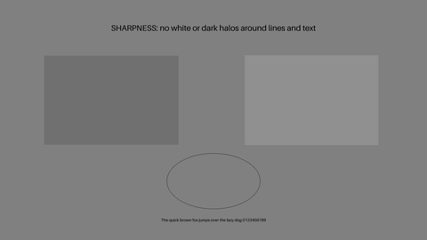

<div align="center">



# Android TV debloat

**Make a low-RAM Google TV / Android TV faster and quieter over ADB: no root, measured, and fully reversible.**

[](LICENSE)
[](docs/guide.md)
[](docs/guide.md#5-pair-and-connect)
[](scripts/)
[](tests/run.sh)
[](skills/android-tv-debloat/SKILL.md)

[Español](README.md) · **English**

[Why](#-why) · [Results](#-results) · [Features](#-features) · [Quick start](#-quick-start) · [AI agent](#-use-with-an-ai-agent) · [Safety](#-safety) · [Picture tuning](#-picture-tuning) · [FAQ](#-faq-and-more) · [Contributing](#-contributing)

</div>

---

## 🤔 Why

A step-by-step guide, helper scripts and an AI-agent skill for one problem: budget smart TVs that feel slow out of the box.

- **2.4 GB of RAM is not enough.** After days of uptime the reference TV had 528 MB available and its zram swap was 96% full, so apps cold-started again and again.
- **Vendor bloat stays resident.** Promotional overlays, channel apps and vendor services run in the background and compete for that RAM.
- **The firmware fights back.** Packages disabled with `pm disable-user` came back enabled after a reboot; only `pm uninstall -k --user 0` persisted.

Reference device: **TCL 65C6K** (Google TV, Android 14, TCL G08 board, MediaTek quad-core up to 1.39 GHz, 2.4 GB RAM, 917 MB zram). The method applies to any Android TV that allows wireless debugging; the package lists are specific to that board.

## 📊 Results

Measured with [`scripts/measure.sh`](scripts/measure.sh) on the reference TV, before and 4 minutes after a reboot (2026-10-21).

| Metric | Before (up for days) | After reboot | Change |
|--------|---------------------|--------------|--------|
| RAM available (`MemAvailable`) | 528 MB `█████░░░░░` | 1031 MB `██████████` | **+95%** |
| Swap (zram) used | 96% `██████████` | 44% `████░░░░░░` | **−52 pts** |

Cold starts in ms (runs 1 / 2 / 3; run 1 is the coldest):

| App | Before | After | Run 1 change |
|-----|--------|-------|--------------|
| Netflix | 1146 / 484 / 477 | 643 / 481 / 410 | −44% |
| YouTube | 1000 / 609 / 623 | 859 / 602 / 482 | −14% |
| Max | 1051 / 763 / 616 | 1061 / 535 / 549 | +1% |
| Prime Video | 940 / 644 / 602 | 890 / 555 / 570 | −5% |

> [!IMPORTANT]
> **Be honest about the cause.** Most of this gain came from the **reboot**, not from debloating: at the "after" measurement the firmware had silently re-enabled the 13 newly disabled packages. The fix was to switch those to `pm uninstall -k --user 0`, which survived later reboots. See [lessons learned](docs/lessons-learned.md).

| Other change | Effect observed |
|--------------|-----------------|
| Removing resident bloat (29 packages) | Less RAM pressure; persisted only after switching 13 of them to `uninstall -k --user 0` |
| AdGuard Private DNS | Ad and tracker domains blocked system-wide (not YouTube or in-app ad tiers) |
| Animations set to 0 | Menus and transitions respond instantly (not measured separately) |
| Full AOT compile (`speed`) | ❌ **Slower**: Netflix 557 → 674 ms, YouTube 621 → 856 ms (reverted) |

RAM is the hard limit. On a 2.4 GB TV, the real fix is an external streaming device with 4 GB of RAM or more.

## ✨ Features

| | Feature | What you get |
|---|---------|--------------|
| 📘 | [Guide](docs/guide.md) | Concepts, setup, backup, measurement, changes, verification and revert, step by step |
| 📦 | [Package reference](docs/packages-tcl-g08.md) | Every package touched on the TCL G08 board: what you lose, risk, and the do-not-touch list |
| 🎨 | [Picture tuning](docs/picture-calibration.md) | Most accurate preset plus black-level and white-clipping checks with test patterns |
| 🤖 | [AI agent skill](skills/android-tv-debloat/SKILL.md) | The same workflow and safety rules, packaged for Claude Code and other agents |
| 🛠️ | [Scripts](scripts/) | `connect`, `backup`, `measure`, `debloat` (dry run by default), `revert`, `patterns.py`, `show-pattern` |
| ✅ | [Tests](tests/run.sh) | 34 offline checks against a fake `adb`; no TV needed |

### How it works



## 🚀 Quick start

**Requirements:** Android platform-tools (`adb`, version 30 or newer for wireless pairing) on macOS, Linux or Windows (WSL or Git Bash for the scripts), with the computer and TV on the same network.

1. **Enable debugging on the TV.** **Settings › System › About**, press **Android TV OS build** 7 times. Then **Settings › System › Developer options** › turn on **Wireless debugging**.

2. **Pair once, then connect.**

   ```sh
   adb pair <TV_IP>:<PAIRING_PORT> <SIX_DIGIT_CODE>
   scripts/connect.sh            # finds the TV via mDNS and connects
   ```

3. **Back up and measure before changing anything.**

   ```sh
   scripts/backup.sh  <TV_IP>:<PORT>
   scripts/measure.sh <TV_IP>:<PORT>
   ```

4. **Review the [package reference](docs/packages-tcl-g08.md), then preview a batch** (dry run is the default).

   ```sh
   scripts/debloat.sh <TV_IP>:<PORT> scripts/lists/tcl-g08-disable.txt --method disable --record-dir revert-lists
   ```

5. **Apply, reboot, re-measure.** Re-run the same command with `--apply`, reboot, run `measure.sh` again, and check that every package stayed in the state you set. Packages the firmware re-enabled go through `--method uninstall` (see [`tcl-g08-uninstall.txt`](scripts/lists/tcl-g08-uninstall.txt)).

6. **Undo everything at any time.**

   ```sh
   scripts/revert.sh <TV_IP>:<PORT> revert-lists
   ```

7. **Turn Wireless debugging off** when you are done.

Run `sh tests/run.sh` to check the scripts offline. The [guide](docs/guide.md) explains why each step exists.

## 🤖 Use with an AI agent

[`skills/android-tv-debloat/`](skills/android-tv-debloat/SKILL.md) encodes the same workflow for an AI coding agent: it asks before every state-changing command, backs up and measures first, applies one batch at a time, never touches the critical packages, and reports gains honestly.

```sh
# Claude Code (user-wide)
cp -R skills/android-tv-debloat ~/.claude/skills/

# Claude Code (this project only)
mkdir -p .claude/skills && cp -R skills/android-tv-debloat .claude/skills/
```

Other agents that support the `SKILL.md` format (for example OpenCode, Codex or Gemini CLI setups) load skills from their own directories; copy the same folder there. Agents without skill support can be given `SKILL.md` as plain instructions.

Sample prompt:

```text
My Google TV is slow. Wireless debugging is on and the TV is at <TV_IP>.
Use the android-tv-debloat skill: back up and measure first, then propose
one batch of packages to disable. Do not change anything without asking me.
```

## 🚨 Safety

> [!WARNING]
> **Use at your own risk.** Vendor firmware differs between brands, boards and even firmware versions. A package that is safe to remove on one TV can break HDMI, Wi-Fi or voice search on another. Every change here is reversible without a factory reset, but only if you take the backup first and keep the revert lists. Nothing here is endorsed by TCL, Google or any vendor.

> [!CAUTION]
> **Never remove these on the TCL G08 board** (full list and consequences in the [package reference](docs/packages-tcl-g08.md#do-not-touch)):
>
> - `com.tcl.tvinput`, `com.tcl.tv`, `com.tcl.suspension`: HDMI inputs show "No Signal"
> - `com.tcl.providers.config`, `com.tcl.initsetup`, `com.tcl.factory.view`: Wi-Fi drops, which also cuts wireless ADB
> - `com.google.android.tv.remote.service`, `com.google.android.katniss`: the remote's mic and voice search stop working
> - `com.google.android.apps.tv.launcherx`, `com.google.android.gms`, `com.android.systemui`: home screen, Play services, system UI
>
> `scripts/debloat.sh` refuses every package in [`scripts/lists/do-not-touch.txt`](scripts/lists/do-not-touch.txt). Treat unknown vendor packages as unknown, not as bloat.

## 🎨 Picture tuning

No colorimeter? You can still get close: pick the most accurate preset (**FILMMAKER MODE** on the reference TV), then check black level and white clipping by eye. Generate the patterns with `python3 scripts/patterns.py patterns/` (needs Pillow) and show them from a USB stick, a casting app, or over ADB with [`scripts/show-pattern.sh`](scripts/show-pattern.sh) (TCL viewer by default).

| Black level | White clipping | Grayscale | Sharpness |
|:-----------:|:--------------:|:---------:|:---------:|
|  |  |  |  |

Previews only: judge the picture with the full-size files on the TV. Full method in [picture tuning without a colorimeter](docs/picture-calibration.md).

## 📚 FAQ and more

<details>
<summary><b>Will this break Netflix, HDMI or voice search?</b></summary>

Not if you stay off the do-not-touch list: HDMI, Wi-Fi, the remote's mic and voice search depend on packages that `debloat.sh` refuses to change. Netflix, YouTube, Max and Prime Video are not touched; the only streaming apps removed on the reference TV were two unused preinstalled ones, which reinstall from the Play Store. After every batch, the guide's [verification step](docs/guide.md#10-verify-nothing-broke) checks HDMI, Wi-Fi, voice and casting; if anything fails, revert the last batch first.

</details>

<details>
<summary><b>Does it work on other brands?</b></summary>

The method (back up, measure, one batch, reboot, verify, revert) works on any Android TV that allows wireless debugging. The package lists and the do-not-touch list were built on a TCL G08 board; other boards and firmware differ, so cross-check every package on your own TV. `show-pattern.sh` defaults to the TCL image viewer; set `VIEWER=<package>/<activity>` for other brands.

</details>

<details>
<summary><b>How do I revert?</b></summary>

Run `scripts/revert.sh <TV_IP>:<PORT> revert-lists` with the folder you passed as `--record-dir`. It restores packages removed for user 0 (`cmd package install-existing --user 0`) and re-enables disabled ones (`pm enable --user 0`). Settings are restored from the values in your backup. Neither `disable-user` nor `uninstall -k --user 0` deletes the system APK, so no factory reset is needed.

</details>

<details>
<summary><b>Does it need root, or free up storage?</b></summary>

No root is needed: everything runs through wireless ADB. It does not free storage either: both methods leave the APK on the system partition. The gain is RAM and background activity, not disk space.

</details>

<details>
<summary><b>Lessons learned (highlights)</b></summary>

| Lesson | Impact |
|--------|--------|
| The firmware silently re-enabled disabled packages at boot | A "gain" was wrongly attributed to debloating |
| A reboot is the biggest single improvement | `MemAvailable` 528 → 1031 MB |
| Full AOT compilation made apps slower | +11% to +38% cold-start time |
| A load average of 16 to 21 is not CPU load | CPU was ~88% idle (MediaTek kernel threads in `D` state) |
| `adb shell` inside a loop eats the loop's input | Only the first package processed; use `adb shell -n` |

All ten lessons, with numbers: [docs/lessons-learned.md](docs/lessons-learned.md).

</details>

<details>
<summary><b>Repository layout</b></summary>

```text
.
├── docs/
│   ├── guide.md                  # full step-by-step guide
│   ├── packages-tcl-g08.md       # package reference and do-not-touch list
│   ├── lessons-learned.md        # pitfalls and negative results
│   ├── picture-calibration.md    # picture tuning without a colorimeter
│   └── assets/                   # banner and pattern previews
├── scripts/
│   ├── connect.sh   backup.sh   measure.sh
│   ├── debloat.sh   revert.sh
│   ├── patterns.py  show-pattern.sh
│   └── lists/                    # do-not-touch, tcl-g08-disable, tcl-g08-uninstall
├── skills/android-tv-debloat/    # AI agent skill (SKILL.md + references/)
└── tests/run.sh                  # offline tests with a fake adb
```

</details>

## 🤝 Contributing

Pull requests with **tested device reports** are welcome, especially package lists for other brands and boards. Please include:

```text
Device:        brand, model, board (getprop ro.product.board)
Android:       version and firmware build
RAM:           MemTotal from scripts/measure.sh
Changes:       packages and method (disable / uninstall -k --user 0)
Persistence:   still in the state you set after a reboot? (yes / no)
Before/after:  measure.sh output (MemAvailable, swap %, cold starts)
Broken:        anything that stopped working, and how you reverted it
```

Remove IP addresses, serials, account names and network names before posting. Run `sh tests/run.sh` if you change the scripts or the do-not-touch list.

## 📄 License

[MIT](LICENSE). Built by Italo Sinisi ([@ItaloFabioSinisiQ](https://github.com/ItaloFabioSinisiQ)) on a TCL 65C6K. Not affiliated with TCL, Google or any vendor.
