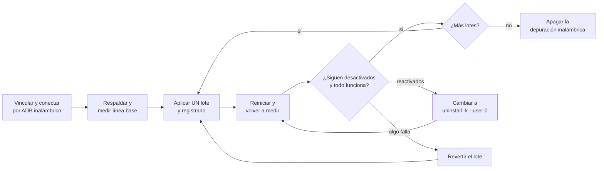

<div align="center">


# Android TV debloat

**Haz que un Google TV / Android TV con poca RAM sea más rápido y silencioso mediante ADB: sin root, con mediciones y totalmente reversible.**

[](LICENSE)
[](docs/guide.md)
[](docs/guide.md#5-pair-and-connect)
[](scripts/)
[](tests/run.sh)
[](skills/android-tv-debloat/SKILL.md)

**Español** · [English](README.en.md)

[Por qué](#-por-qué) · [Resultados](#-resultados) · [Características](#-características) · [Inicio rápido](#-inicio-rápido) · [Agente de IA](#-uso-con-un-agente-de-ia) · [Seguridad](#-seguridad) · [Ajuste de imagen](#-ajuste-de-imagen) · [Preguntas frecuentes](#-preguntas-frecuentes-y-más) · [Contribuir](#-contribuir)

</div>

---

## 🤔 Por qué

Una guía paso a paso, scripts de apoyo y un skill para agentes de IA, enfocados en un solo problema: los televisores inteligentes económicos que se sienten lentos desde el primer día.

- **2.4 GB de RAM no son suficientes.** Tras varios días encendido, el televisor de referencia tenía 528 MB disponibles y su swap zram estaba lleno al 96 %, por lo que las apps volvían a hacer arranque en frío una y otra vez.
- **El bloatware del fabricante permanece residente.** Superposiciones promocionales, apps de canales y servicios del fabricante se ejecutan en segundo plano y compiten por esa RAM.
- **El firmware se resiste.** Los paquetes desactivados con `pm disable-user` volvían a habilitarse después de reiniciar; solo `pm uninstall -k --user 0` se mantuvo.

Dispositivo de referencia: **TCL 65C6K** (Google TV, Android 14, placa TCL G08, MediaTek de cuatro núcleos hasta 1.39 GHz, 2.4 GB de RAM, 917 MB de zram). El método sirve para cualquier Android TV que permita la depuración inalámbrica; las listas de paquetes son específicas de esa placa.

## 📊 Resultados

Medido con [`scripts/measure.sh`](scripts/measure.sh) en el televisor de referencia, antes y 4 minutos después de un reinicio (2026-10-21).

| Métrica | Antes (encendido varios días) | Después del reinicio | Cambio |
|--------|---------------------|--------------|--------|
| RAM disponible (`MemAvailable`) | 528 MB `█████░░░░░` | 1031 MB `██████████` | **+95 %** |
| Swap (zram) en uso | 96 % `██████████` | 44 % `████░░░░░░` | **−52 pts** |

Arranques en frío en ms (ejecuciones 1 / 2 / 3; la ejecución 1 es la más fría):

| App | Antes | Después | Cambio en la ejecución 1 |
|-----|--------|-------|--------------|
| Netflix | 1146 / 484 / 477 | 643 / 481 / 410 | −44 % |
| YouTube | 1000 / 609 / 623 | 859 / 602 / 482 | −14 % |
| Max | 1051 / 763 / 616 | 1061 / 535 / 549 | +1 % |
| Prime Video | 940 / 644 / 602 | 890 / 555 / 570 | −5 % |

> [!IMPORTANT]
> **Sé honesto sobre la causa.** La mayor parte de esta mejora vino del **reinicio**, no del debloat: en la medición "después", el firmware había vuelto a habilitar en silencio los 13 paquetes recién desactivados. La solución fue cambiarlos a `pm uninstall -k --user 0`, que sobrevivió a los reinicios posteriores. Consulta las [lecciones aprendidas](docs/lessons-learned.md).

| Otro cambio | Efecto observado |
|--------------|-----------------|
| Eliminar bloatware residente (29 paquetes) | Menos presión sobre la RAM; persistió solo después de cambiar 13 de ellos a `uninstall -k --user 0` |
| DNS privado de AdGuard | Dominios de anuncios y rastreadores bloqueados en todo el sistema (no en YouTube ni en los planes con anuncios dentro de las apps) |
| Animaciones en 0 | Los menús y las transiciones responden al instante (no se midió por separado) |
| Compilación AOT completa (`speed`) | ❌ **Más lento**: Netflix 557 → 674 ms, YouTube 621 → 856 ms (revertido) |

La RAM es el límite real. En un televisor de 2.4 GB, la verdadera solución es un dispositivo de streaming externo con 4 GB de RAM o más.

## ✨ Características

| | Característica | Qué obtienes |
|---|---------|--------------|
| 📘 | [Guía](docs/guide.md) | Conceptos, configuración, respaldo, medición, cambios, verificación y reversión, paso a paso |
| 📦 | [Referencia de paquetes](docs/packages-tcl-g08.md) | Cada paquete modificado en la placa TCL G08: qué se pierde, el riesgo y la lista de paquetes que no se deben tocar |
| 🎨 | [Ajuste de imagen](docs/picture-calibration.md) | El preajuste más preciso, además de comprobaciones de nivel de negro y recorte de blancos con patrones de prueba |
| 🤖 | [Skill para agentes de IA](skills/android-tv-debloat/SKILL.md) | El mismo flujo de trabajo y las mismas reglas de seguridad, empaquetados para Claude Code y otros agentes |
| 🛠️ | [Scripts](scripts/) | `connect`, `backup`, `measure`, `debloat` (simulación por defecto), `revert`, `patterns.py`, `show-pattern` |
| ✅ | [Pruebas](tests/run.sh) | 34 comprobaciones sin conexión contra un `adb` simulado; no se necesita el televisor |

> La documentación detallada está en inglés.

### Cómo funciona



## 🚀 Inicio rápido

**Requisitos:** Android platform-tools (`adb`, versión 30 o posterior para el emparejamiento inalámbrico) en macOS, Linux o Windows (WSL o Git Bash para los scripts), con la computadora y el televisor en la misma red.

1. **Activa la depuración en el televisor.** En **Ajustes › Sistema › Información**, presiona **Compilación del SO de Android TV** 7 veces. Luego, en **Ajustes › Sistema › Opciones de desarrollador**, activa **Depuración inalámbrica**.

2. **Empareja una vez y luego conéctate.**

   ```sh
   adb pair <TV_IP>:<PAIRING_PORT> <SIX_DIGIT_CODE>
   scripts/connect.sh            # finds the TV via mDNS and connects
   ```

3. **Haz un respaldo y mide antes de cambiar cualquier cosa.**

   ```sh
   scripts/backup.sh  <TV_IP>:<PORT>
   scripts/measure.sh <TV_IP>:<PORT>
   ```

4. **Revisa la [referencia de paquetes](docs/packages-tcl-g08.md) y luego previsualiza un lote** (la simulación es el modo por defecto).

   ```sh
   scripts/debloat.sh <TV_IP>:<PORT> scripts/lists/tcl-g08-disable.txt --method disable --record-dir revert-lists
   ```

5. **Aplica, reinicia y vuelve a medir.** Ejecuta el mismo comando con `--apply`, reinicia, vuelve a ejecutar `measure.sh` y comprueba que cada paquete siga en el estado que definiste. Los paquetes que el firmware vuelva a habilitar se procesan con `--method uninstall` (consulta [`tcl-g08-uninstall.txt`](scripts/lists/tcl-g08-uninstall.txt)).

6. **Deshaz todo en cualquier momento.**

   ```sh
   scripts/revert.sh <TV_IP>:<PORT> revert-lists
   ```

7. **Desactiva la Depuración inalámbrica** cuando termines.

Ejecuta `sh tests/run.sh` para comprobar los scripts sin conexión. La [guía](docs/guide.md) explica por qué existe cada paso.

## 🤖 Uso con un agente de IA

[`skills/android-tv-debloat/`](skills/android-tv-debloat/SKILL.md) codifica el mismo flujo de trabajo para un agente de programación con IA: pide confirmación antes de cada comando que cambia el estado, hace un respaldo y mide primero, aplica un lote a la vez, nunca toca los paquetes críticos e informa las mejoras con honestidad.

```sh
# Claude Code (user-wide)
cp -R skills/android-tv-debloat ~/.claude/skills/

# Claude Code (this project only)
mkdir -p .claude/skills && cp -R skills/android-tv-debloat .claude/skills/
```

Otros agentes compatibles con el formato `SKILL.md` (por ejemplo, configuraciones de OpenCode, Codex o Gemini CLI) cargan los skills desde sus propios directorios; copia ahí la misma carpeta. A los agentes sin soporte para skills se les puede entregar `SKILL.md` como instrucciones en texto plano.

Ejemplo de prompt:

```text
Mi Google TV está lenta. La depuración inalámbrica está activa y la TV está en <TV_IP>.
Usa el skill android-tv-debloat: primero respalda y mide, luego propón
un lote de paquetes para desactivar. No cambies nada sin preguntarme.
```

## 🚨 Seguridad

> [!WARNING]
> **Úsalo bajo tu propio riesgo.** El firmware de cada fabricante varía entre marcas, placas e incluso versiones de firmware. Un paquete que es seguro eliminar en un televisor puede dañar el HDMI, el Wi-Fi o la búsqueda por voz en otro. Todos los cambios aquí son reversibles sin restablecer de fábrica, pero solo si haces el respaldo primero y conservas las listas de reversión. Nada de esto está respaldado por TCL, Google ni ningún fabricante.

> [!CAUTION]
> **Nunca elimines estos paquetes en la placa TCL G08** (lista completa y consecuencias en la [referencia de paquetes](docs/packages-tcl-g08.md#do-not-touch)):
>
> - `com.tcl.tvinput`, `com.tcl.tv`, `com.tcl.suspension`: las entradas HDMI muestran "Sin señal"
> - `com.tcl.providers.config`, `com.tcl.initsetup`, `com.tcl.factory.view`: se cae el Wi-Fi, lo que también corta el ADB inalámbrico
> - `com.google.android.tv.remote.service`, `com.google.android.katniss`: el micrófono del control remoto y la búsqueda por voz dejan de funcionar
> - `com.google.android.apps.tv.launcherx`, `com.google.android.gms`, `com.android.systemui`: pantalla de inicio, servicios de Play, interfaz del sistema
>
> `scripts/debloat.sh` rechaza todos los paquetes de [`scripts/lists/do-not-touch.txt`](scripts/lists/do-not-touch.txt). Trata los paquetes desconocidos del fabricante como desconocidos, no como bloatware.

## 🎨 Ajuste de imagen

¿No tienes colorímetro? Aun así puedes acercarte bastante: elige el preajuste más preciso (**Imagen › Modo de imagen › FILMMAKER MODE** en el televisor de referencia) y luego comprueba a simple vista el nivel de negro y el recorte de blancos. Genera los patrones con `python3 scripts/patterns.py patterns/` (requiere Pillow) y muéstralos desde una memoria USB, una app de transmisión o mediante ADB con [`scripts/show-pattern.sh`](scripts/show-pattern.sh) (usa el visor de TCL por defecto).

| Nivel de negro | Recorte de blancos | Escala de grises | Nitidez |
|:-----------:|:--------------:|:---------:|:---------:|
|  |  |  |  |

Son solo vistas previas: evalúa la imagen con los archivos a tamaño completo en el televisor. El método completo está en [ajuste de imagen sin colorímetro](docs/picture-calibration.md).

## 📚 Preguntas frecuentes y más

<details>
<summary><b>¿Esto dañará Netflix, el HDMI o la búsqueda por voz?</b></summary>

No, si te mantienes alejado de la lista de paquetes que no se deben tocar: el HDMI, el Wi-Fi, el micrófono del control remoto y la búsqueda por voz dependen de paquetes que `debloat.sh` se niega a modificar. Netflix, YouTube, Max y Prime Video no se tocan; las únicas apps de streaming eliminadas en el televisor de referencia fueron dos preinstaladas que no se usaban, y se pueden reinstalar desde Play Store. Después de cada lote, el [paso de verificación](docs/guide.md#10-verify-nothing-broke) de la guía comprueba el HDMI, el Wi-Fi, la voz y la transmisión; si algo falla, revierte primero el último lote.

</details>

<details>
<summary><b>¿Funciona en otras marcas?</b></summary>

El método (respaldar, medir, un lote, reiniciar, verificar, revertir) funciona en cualquier Android TV que permita la depuración inalámbrica. Las listas de paquetes y la lista de paquetes que no se deben tocar se crearon en una placa TCL G08; otras placas y firmwares son distintos, así que verifica cada paquete en tu propio televisor. `show-pattern.sh` usa por defecto el visor de imágenes de TCL; define `VIEWER=<package>/<activity>` para otras marcas.

</details>

<details>
<summary><b>¿Cómo revierto los cambios?</b></summary>

Ejecuta `scripts/revert.sh <TV_IP>:<PORT> revert-lists` con la carpeta que pasaste en `--record-dir`. Restaura los paquetes eliminados para el usuario 0 (`cmd package install-existing --user 0`) y vuelve a habilitar los desactivados (`pm enable --user 0`). Los ajustes se restauran con los valores de tu respaldo. Ni `disable-user` ni `uninstall -k --user 0` borran el APK del sistema, así que no hace falta restablecer de fábrica.

</details>

<details>
<summary><b>¿Necesita root o libera almacenamiento?</b></summary>

No necesita root: todo se ejecuta mediante ADB inalámbrico. Tampoco libera almacenamiento: ambos métodos dejan el APK en la partición del sistema. La mejora está en la RAM y en la actividad en segundo plano, no en el espacio en disco.

</details>

<details>
<summary><b>Lecciones aprendidas (lo más destacado)</b></summary>

| Lección | Impacto |
|--------|--------|
| El firmware volvió a habilitar en silencio los paquetes desactivados al arrancar | Una "mejora" se atribuyó por error al debloat |
| Un reinicio es la mayor mejora individual | `MemAvailable` 528 → 1031 MB |
| La compilación AOT completa hizo más lentas las apps | De +11 % a +38 % en el tiempo de arranque en frío |
| Una carga promedio de 16 a 21 no es carga de CPU | La CPU estaba ~88 % inactiva (hilos del kernel de MediaTek en estado `D`) |
| `adb shell` dentro de un bucle consume la entrada del bucle | Solo se procesaba el primer paquete; usa `adb shell -n` |

Las diez lecciones, con cifras: [docs/lessons-learned.md](docs/lessons-learned.md).

</details>

<details>
<summary><b>Estructura del repositorio</b></summary>

```text
.
├── docs/
│   ├── guide.md                  # full step-by-step guide
│   ├── packages-tcl-g08.md       # package reference and do-not-touch list
│   ├── lessons-learned.md        # pitfalls and negative results
│   ├── picture-calibration.md    # picture tuning without a colorimeter
│   └── assets/                   # banner and pattern previews
├── scripts/
│   ├── connect.sh   backup.sh   measure.sh
│   ├── debloat.sh   revert.sh
│   ├── patterns.py  show-pattern.sh
│   └── lists/                    # do-not-touch, tcl-g08-disable, tcl-g08-uninstall
├── skills/android-tv-debloat/    # AI agent skill (SKILL.md + references/)
└── tests/run.sh                  # offline tests with a fake adb
```

</details>

## 🤝 Contribuir

Las pull requests con **reportes de dispositivos probados** son bienvenidas, en especial listas de paquetes para otras marcas y placas. Incluye lo siguiente:

```text
Device:        brand, model, board (getprop ro.product.board)
Android:       version and firmware build
RAM:           MemTotal from scripts/measure.sh
Changes:       packages and method (disable / uninstall -k --user 0)
Persistence:   still in the state you set after a reboot? (yes / no)
Before/after:  measure.sh output (MemAvailable, swap %, cold starts)
Broken:        anything that stopped working, and how you reverted it
```

Elimina direcciones IP, números de serie, nombres de cuenta y nombres de red antes de publicar. Ejecuta `sh tests/run.sh` si modificas los scripts o la lista de paquetes que no se deben tocar.

## 📄 Licencia

[MIT](LICENSE). Creado por Italo Sinisi ([@ItaloFabioSinisiQ](https://github.com/ItaloFabioSinisiQ)) en un TCL 65C6K. Sin afiliación con TCL, Google ni ningún fabricante.
