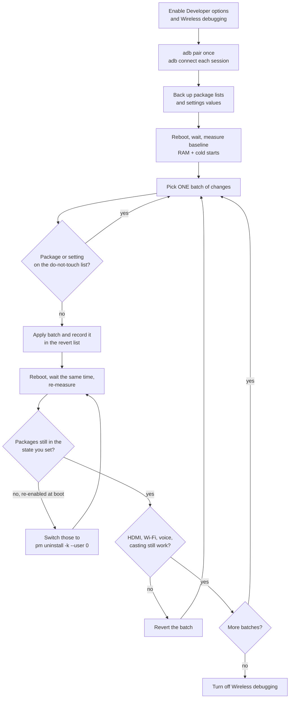

# Debloat and tune a low-RAM Android TV over ADB

This guide takes you from a stock Google TV to a lighter, ad-reduced one, with a backup, a measured baseline, and a revert path for every change. No root and no factory reset are needed.

The reference device is a TCL 65C6K (Google TV, Android 14, TCL G08 board, MediaTek quad-core up to 1.39 GHz, 2.4 GB RAM, 917 MB zram). Commands are generic; package names are not. Check the [package reference](packages-tcl-g08.md) and treat anything outside it as unknown on your TV.

> [!WARNING]
> At your own risk. Vendor firmware differs. Back up first, change one batch at a time, and keep the revert lists.

## Contents

1. [The workflow at a glance](#1-the-workflow-at-a-glance)
2. [Concepts you need first](#2-concepts-you-need-first)
3. [Prerequisites](#3-prerequisites)
4. [Enable Developer options and Wireless debugging](#4-enable-developer-options-and-wireless-debugging)
5. [Pair and connect](#5-pair-and-connect)
6. [Back up before any change](#6-back-up-before-any-change)
7. [Measure a baseline](#7-measure-a-baseline)
8. [Apply changes](#8-apply-changes)
9. [Reboot and re-measure](#9-reboot-and-re-measure)
10. [Verify nothing broke](#10-verify-nothing-broke)
11. [Revert](#11-revert)
12. [Finish and maintain](#12-finish-and-maintain)

## 1. The workflow at a glance



## 2. Concepts you need first

### RAM is the bottleneck

On a 2.4 GB TV, the system, Google TV launcher and Google Play services already use most of the memory. When an app needs more, Android's low-memory killer (`lmkd`) closes background apps. The result: almost every app you switch to opens from scratch, and the UI stutters while memory is reclaimed.

The CPU is rarely the limit. On the reference TV it was about 88% idle, at 63 °C, with all four cores reaching their 1.39 GHz maximum and no thermal throttling. Removing packages helps only when those packages keep processes **resident** in memory (services started at boot, background sync, analytics). Removing an app that never runs saves nothing at runtime.

### Cold, warm and hot starts

| Start type | What is already in memory | Typical cost |
|------------|---------------------------|--------------|
| Cold | Nothing: the process must be created | Highest |
| Warm | The process, but the activity must be recreated | Medium |
| Hot | Process and activity, just brought to front | Lowest |

This guide measures cold starts: `am force-stop` kills the app, then `am start -W` launches it and reports `TotalTime`, the time until the first frame is drawn (not until content is playable).

Force-stopping kills the process, but the Linux page cache may still hold the app's code files. That is why run 1 is usually the slowest and runs 2 and 3 are faster. Report all three runs, not only an average: run 1 reflects real-life "opened it after a while", runs 2 and 3 show the best case.

### zram and swap

The TV has no disk swap. It uses **zram**: a compressed swap area inside RAM (917 MB on the reference TV). Pages that are not in use get compressed instead of the app being killed. It costs CPU time to compress and decompress, and when zram is nearly full, the system is under heavy memory pressure.

`SwapTotal` and `SwapFree` in `/proc/meminfo` show it. After days without a reboot, the reference TV had 96% of swap used and only 528 MB `MemAvailable`. One reboot brought that to 44% and 1031 MB.

### Why the load average misleads on MediaTek

Linux counts tasks in uninterruptible sleep (state `D`) as load. MediaTek TV kernels run many driver threads (HDMI Rx, eARC, panel, DRAM, SPDIF) that wait in `D` state permanently. On the reference TV, 16 such threads produced a load average of 16 to 21 with the CPU mostly idle.

Use real CPU usage instead:

```sh
adb shell top -b -n 1 -m 10          # per-process %CPU
adb shell cat /proc/stat             # take two samples, compare idle time
adb shell "ps -A -o PID,S,NAME | grep ' D '"      # the D-state threads
```

### What `pm disable-user` and `pm uninstall -k --user 0` really do

| | `pm disable-user --user 0 <pkg>` | `pm uninstall -k --user 0 <pkg>` |
|---|---|---|
| Effect | Package stays installed for user 0 but cannot run | Package is marked "not installed" for user 0 |
| APK on `/system` | Untouched | Untouched |
| App data | Kept | Kept (`-k`) |
| Storage freed | None | None for system apps |
| Shows in `pm list packages` | Yes (and in `-d`) | No (only in `-u`) |
| Undo | `pm enable --user 0 <pkg>` | `cmd package install-existing --user 0 <pkg>` |
| Survives reboot | Usually; some firmwares reset it at boot | Yes, on the reference TV |
| Factory reset | Restores it | Restores it |

**Neither command removes the system APK.** The system partition is read-only without root. Both only change the package state for user 0, which is why both are safe to undo.

Some vendor firmwares reset package states at boot. On the reference TV, 13 packages disabled with `disable-user` came back after a reboot with state "default" (`enabled=0` in `dumpsys package`), while 16 others disabled the day before stayed disabled. The same 13, removed with `pm uninstall -k --user 0`, stayed removed. Always check after a reboot.

Third-party apps that came preinstalled (for example, a streaming app you never use) can be removed for the user with `pm uninstall --user 0 <pkg>` and reinstalled later from the Play Store.

### What Private DNS ad-blocking does

Android's **Private DNS** sends all DNS lookups over TLS to the server you choose. An ad-blocking resolver such as AdGuard DNS answers with a null address for known ad and tracker domains, so those requests fail system-wide, including inside the launcher and vendor services.

Limits:

- It cannot block ads served from the same domains as the content: YouTube ads and the ad tiers of Netflix or Prime Video still play.
- The DNS provider sees every domain the TV looks up. Pick one you trust.
- If the resolver is unreachable, the TV loses name resolution. Revert with one command (below).

## 3. Prerequisites

| Need | How |
|------|-----|
| `adb` (platform-tools) | macOS: `brew install android-platform-tools`. Debian/Ubuntu: `sudo apt install adb`. Windows: download "SDK Platform-Tools" from developer.android.com. Android Studio users already have it under the SDK `platform-tools` folder. |
| A POSIX shell for the scripts | macOS or Linux terminal; on Windows use WSL or Git Bash, or type the commands manually |
| Same network | The computer and the TV must reach each other on the local network |
| Time | About an hour, including reboots and measurements |

Check your version: `adb version` (wireless pairing needs platform-tools 30 or newer).

## 4. Enable Developer options and Wireless debugging

1. On the TV, open **Settings › System › About**.
2. Select **Android TV OS build** 7 times, until the TV says you are a developer.
3. Go back to **Settings › System**. **Developer options** now appears near the bottom.
4. In **Developer options**, turn on **Wireless debugging**. Some firmwares also require **USB debugging** to be on.
5. Select the **Wireless debugging** entry itself (not only its toggle) to see the IP address and port.

> [!NOTE]
> Some TCL TVs show a **Control4** option in **Settings › System**. It is for home-automation control over the network and has nothing to do with ADB. Leave it off.

## 5. Pair and connect

Android 11 and newer use a pairing step instead of the old fixed port 5555.

**Pair once.** In **Wireless debugging**, choose **Pair device with pairing code**. The TV shows a pairing address and a 6-digit code:

```sh
adb pair <TV_IP>:<PAIRING_PORT> <SIX_DIGIT_CODE>
```

The pairing port is different from the connection port. Pairing is remembered across reboots.

**Connect every session.** The connection port changes every time the TV reboots or Wireless debugging restarts, and Wireless debugging may turn itself off after a reboot. Find the current port over mDNS:

```sh
adb mdns check
adb mdns services          # look for _adb-tls-connect   <TV_IP>:<PORT>
adb connect <TV_IP>:<PORT>
adb devices -l
```

Or run `scripts/connect.sh`, which does the discovery and connection for you.

If more than one device is connected, pass the serial explicitly with `adb -s <TV_IP>:<PORT> ...`. The scripts always take the serial as their first argument.

> [!TIP]
> When running `adb shell` inside a `while read` loop, use `adb shell -n`. Without `-n`, adb consumes the loop's standard input and only the first line is processed.

## 6. Back up before any change

Record the current state so you can prove what you changed and restore it.

```sh
scripts/backup.sh <TV_IP>:<PORT>
```

It is read-only and saves, in a timestamped folder: all, system, user, disabled and user-uninstalled package lists; all `settings` namespaces; the specific values this guide changes; device properties; and memory info.

Manual equivalent for the essentials:

```sh
adb shell pm list packages    | sed 's/package://' | sort > packages_all.txt
adb shell pm list packages -d | sed 's/package://' | sort > packages_disabled.txt
adb shell settings get global window_animation_scale
adb shell settings get global transition_animation_scale
adb shell settings get global animator_duration_scale
adb shell settings get global private_dns_mode
adb shell settings get secure screensaver_enabled
```

The backup and the revert lists are two different things:

| Folder | Written by | Contents | Used for |
|--------|------------|----------|----------|
| Backup folder (`backup-YYYYMMDD-HHMMSS/`, or the `OUT_DIR` you pass) | `scripts/backup.sh`, once, before any change | Package lists, settings, device properties | Proving what changed; restoring settings by hand |
| Record folder (`--record-dir`, default: the current directory) | `scripts/debloat.sh --apply`, every batch | `disabled_by_us.txt`, `uninstalled_by_us.txt` | `scripts/revert.sh` |

The revert lists hold:

- `disabled_by_us.txt`: every package you disable with `pm disable-user`.
- `uninstalled_by_us.txt`: every package you remove with `pm uninstall -k --user 0`.

Use one fixed record folder for the whole session, for example `--record-dir revert-lists`, and pass the same folder to `scripts/revert.sh`. If you work by hand, append to these files yourself.

## 7. Measure a baseline

Without a baseline you cannot tell whether a change helped. Uptime matters more than anything else on a low-RAM TV, so control for it:

1. Reboot the TV.
2. Wait a fixed time (for example 5 minutes) without using it.
3. Measure.

Use the same procedure after every batch. If you measure "before" on a TV that has been up for days and "after" on a freshly rebooted one, you are measuring the reboot.

```sh
scripts/measure.sh <TV_IP>:<PORT>              # Netflix, YouTube, Max, Prime Video
scripts/measure.sh <TV_IP>:<PORT> com.some.app # or your own list
```

What it does, step by step:

```sh
# Memory
adb shell cat /proc/meminfo | grep -E 'MemTotal|MemAvailable|SwapTotal|SwapFree'
adb shell dumpsys -t 60 meminfo > dumpsys_meminfo.txt   # plain dumpsys meminfo times out

# Resolve the TV launcher activity of an app
adb shell cmd package resolve-activity --brief \
  -a android.intent.action.MAIN -c android.intent.category.LEANBACK_LAUNCHER com.netflix.ninja
# last line, e.g. com.netflix.ninja/.MainActivity

# Cold start, repeated 3 times
adb shell am force-stop com.netflix.ninja
adb shell am start -W -n <PACKAGE>/<ACTIVITY>      # read TotalTime (ms)
adb shell input keyevent KEYCODE_HOME
```

The script also records `uptime` and memory after the apps were opened, which shows how much headroom is left with your usual apps loaded.

`measure.sh` force-stops and launches apps on screen. Run it when nobody is watching.

## 8. Apply changes

Change one batch, then go to step 9 before the next batch. Each change below lists its revert command.

### 8.1 Ad-blocking Private DNS

```sh
adb shell settings put global private_dns_mode hostname
adb shell settings put global private_dns_specifier dns.adguard-dns.com
```

Check: `adb shell ping -c 1 doubleclick.net` should resolve to a null or loopback address while normal sites still load.

Revert: `adb shell settings put global private_dns_mode off` (or restore the values from your backup).

### 8.2 Animations off

```sh
adb shell settings put global window_animation_scale 0
adb shell settings put global transition_animation_scale 0
adb shell settings put global animator_duration_scale 0
```

Revert: the same commands with `1` (the usual default) or the values in your backup. `0.5` is a middle ground.

### 8.3 Screensaver (Ambient mode) off

Ambient mode keeps its process and images in memory.

```sh
adb shell settings put secure screensaver_enabled 0
```

Revert: `adb shell settings put secure screensaver_enabled 1`.

### 8.4 Packages, in batches

1. Choose a batch from the [package reference](packages-tcl-g08.md). Skip anything you use.
2. Never include a package from the [do-not-touch list](packages-tcl-g08.md#do-not-touch).
3. Preview, then apply:

   ```sh
   scripts/debloat.sh <TV_IP>:<PORT> my-batch.txt --method disable --record-dir revert-lists          # dry run
   scripts/debloat.sh <TV_IP>:<PORT> my-batch.txt --method disable --record-dir revert-lists --apply
   ```

   Manual equivalent, one package at a time:

   ```sh
   adb shell pm disable-user --user 0 <pkg>
   mkdir -p revert-lists && echo <pkg> >> revert-lists/disabled_by_us.txt
   ```

4. Reboot and check the state (step 9). If the firmware re-enabled them, remove them for the user instead:

   ```sh
   scripts/debloat.sh <TV_IP>:<PORT> my-batch.txt --method uninstall --record-dir revert-lists --apply
   # manual: adb shell pm uninstall -k --user 0 <pkg>; echo <pkg> >> revert-lists/uninstalled_by_us.txt
   ```

Revert one package: `adb shell pm enable --user 0 <pkg>` or `adb shell cmd package install-existing --user 0 <pkg>`.

### 8.5 Preinstalled third-party apps you never use

```sh
adb shell pm uninstall --user 0 <pkg>
```

Revert: install the app again from the Play Store.

### 8.6 Things that did not help (skip them)

| Idea | Why to skip |
|------|-------------|
| `cmd package compile -m speed -f` (full AOT) | Made cold starts slower on 2.4 GB RAM: bigger compiled code, more to load. Revert with `-m speed-profile -f`. |
| Background process limit (Developer options) | Forces more apps to cold-start. |
| Apps-only mode | Also disables Search and voice search. |
| Third-party launcher | Opened faster in isolation but made no difference in daily use and used RAM and CPU of its own. |

Details and numbers are in [lessons learned](lessons-learned.md).

## 9. Reboot and re-measure

```sh
adb reboot
# wait for the TV, re-enable Wireless debugging if it turned off, then:
scripts/connect.sh
# wait the same fixed time as the baseline, then:
scripts/measure.sh <TV_IP>:<PORT>
```

Compare `meminfo.txt` and `coldstart.txt` with the baseline folder. Attribute gains carefully: if the baseline was taken on a long-running TV, most of the improvement is the reboot.

## 10. Verify nothing broke

**Package state persisted:**

```sh
adb shell pm list packages -d | wc -l        # should equal your disabled count
while read -r p; do
  adb shell -n pm list packages | grep -qx "package:$p" && echo "STILL INSTALLED: $p"
done < uninstalled_by_us.txt
adb shell dumpsys package <pkg> | grep -o ' enabled=[0-9]'   # 0 = default, 3 = disabled-user
```

**Features still work** (test with the remote, not only with ADB):

| Check | Why |
|-------|-----|
| Every HDMI input shows a picture | Several TCL packages hold HDMI-related permissions |
| Game console auto-switches to game mode | Uses the TCL game bar service |
| Wi-Fi stays connected after a reboot | Some config packages break Wi-Fi |
| Remote voice button and voice search | Depend on `remote.service` and `katniss` |
| Casting (Chromecast built-in) | Should be unaffected by removing Miracast or AirPlay |
| Quick settings panel opens | Served by `com.tcl.suspension` on TCL |
| System update screen opens | On the reference TV it is `com.google.android.gms/.update.SystemUpdatePanoActivity` |

**Wi-Fi band**, if you are unsure which band the TV uses (network names can be misleading):

```sh
adb shell dumpsys wifi | grep -m1 -i 'frequency'
```

If anything fails, revert the last batch first (step 11), then retry with a smaller batch.

## 11. Revert

Everything at once:

```sh
scripts/revert.sh <TV_IP>:<PORT> revert-lists     # the folder passed as --record-dir
adb reboot
```

It runs `cmd package install-existing --user 0` for every line in `uninstalled_by_us.txt`, then `pm enable --user 0` for every line in `disabled_by_us.txt`. It exits with an error if neither file is in the folder. Settings are reverted with the commands in step 8 and the values from your backup. A factory reset also restores everything, but erases your accounts and apps.

## 12. Finish and maintain

1. Turn **Wireless debugging** off in Developer options. A paired, listening ADB service is unnecessary attack surface on your network.
2. Keep the backup folder and both revert lists.
3. Reboot the TV about once a week. On a 2.4 GB TV this is the single most effective habit.
4. After a firmware update, re-check package state (step 10): updates can restore removed packages or reset states.

If the TV is still slow after this, the hardware is the limit. An external streaming device with 4 GB of RAM or more, with the TV used only as a display, is the real fix.

To tune the picture as well, see [picture tuning without a colorimeter](picture-calibration.md).
